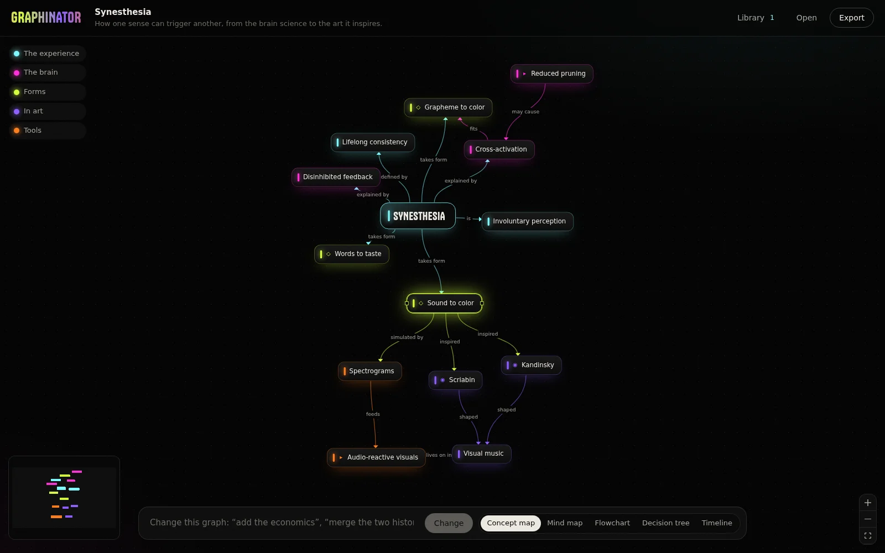

# Graphinator

Turn any idea into a graph you can explore.



Type a concept, a question or a process, or drop in a document. Graphinator maps it with Claude, lays it out, and lets you keep going from any node: expand it, ask for an explanation, edit it, or tell the whole graph how to change.

## What it makes

| Kind | Good for |
| --- | --- |
| Concept map | Ideas and how they relate, with cross-links |
| Mind map | One central idea branching outward |
| Flowchart | A process, step by step |
| Decision tree | Questions that branch into outcomes |
| Timeline | Events in order |

Any graph can be re-laid out as any other kind with one click.

## Working with a graph

- **Expand** a node to grow 3 to 6 new ideas from it, optionally toward a direction you type.
- **Explain** a node for two short paragraphs on what it is and how it connects.
- **Change** the whole graph in plain words: "add the economics", "make it simpler", "split the history branch by decade".
- Click a group in the legend to isolate it. Drag between nodes to connect them. Delete removes the selected node.
- Every graph is saved to the **Library** on this computer.
- **Export** to PNG, SVG, a Markdown outline, Mermaid (pastes into GitHub and Notion), or a Graphinator file you can open again.

## Run it

```bash
git clone https://github.com/wexloops/graphinator-v01.git graphinator
cd graphinator
npm install
npm run dev             # http://localhost:3012
```

Click **API key** in the top bar and paste your Anthropic key. Graphinator checks it with Anthropic and saves it to `.env` in this folder. You can also put `ANTHROPIC_API_KEY=...` in `.env` yourself (see `.env.example`); the app's `.env` takes priority over a key exported in your shell.

`npm run build && npm start` serves the production build on the same port. **See an example** on the start screen works without a key.

The key is read by the local server only and is never sent to the browser. Key changes are accepted only from `localhost`. Graphinator uses `claude-opus-5-5` by default; set `GRAPHINATOR_MODEL` in `.env` to use another model. Requests use structured outputs, so every reply is a valid graph.

## Stack

React, [React Flow](https://reactflow.dev), [ELK](https://eclipse.dev/elk/) for layout, the Anthropic TypeScript SDK, Zod, Vite. `npm test` runs the layout, schema and export tests.

## History

Version 3 replaces both Graphinator v1 (flowcharts from prompts) and Graphinator Pro (AI media workflows). It keeps one job, mapping ideas, and does it properly. The earlier code is in this repository's history.

MIT License. Made by [HYPRGRPH](https://hyprgrph.xyz).
